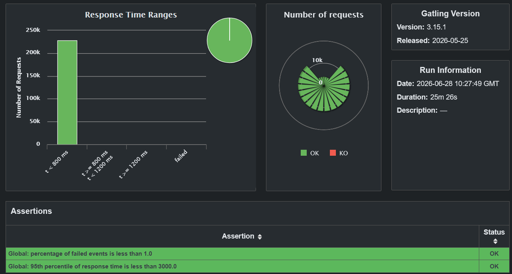

# Load Testing

Load testing evaluates the system's responsiveness and stability under concurrent users. It targets the critical path: Traefik and Oathkeeper in front of the Spring Boot backend. That chain has the highest per-request overhead, because each request involves session validation against Kratos and permission checks against Keto.

The tool is **Gatling**, run through Maven. The simulation was recorded with Gatling's proxy recorder to capture a realistic user journey, then edited by hand to add think times, a closed-model concurrency profile, and a repeated work loop that sustains session overlap.

## Performance requirements

The system is held to the following:

- Stay responsive for up to **20 simultaneous authenticated users**.
- Keep p95 API latency at or below **3000 ms** under that load.

The test deliberately goes well beyond this, using **500 concurrent users**, to show how much headroom there is.

## Environment

- The stack was deployed with `docker-compose.load-testing.yaml`, a production-like profile with **load balancing disabled** and **499 users pre-inserted**, so account creation doesn't interfere with measurements. See [Deployment › Docker Compose](../deployment/docker-compose.md#load-testing).
- Tests ran **locally against the Docker Compose stack**, on the same machine, to isolate system performance from network latency.

## The simulation

It uses a closed model targeting 500 concurrent users. Concurrency ramps up over about 2 minutes, holds at peak for 20 minutes, then winds down over about 2 minutes.

Each virtual user starts with a single login: it initiates a Kratos browser login flow, extracts the flow ID and CSRF token, submits its credentials, and receives a session cookie. A 3–6 second pause follows, simulating reading the dashboard.

The following workflow then repeats **at least three times** per session, with realistic think times:

1. Open the home screen.
2. Fill in and submit a new project form (4–8 s).
3. Open the project and read it (2–4 s).
4. Create a stakeholder (3–6 s).
5. Browse the stakeholder list.
6. Browse functionalities, then create one (3–7 s).
7. View the functional requirements list.
8. Write and submit a functional requirement, the longest pause at 5–12 s.
9. Review the requirement's detail page.
10. Link the stakeholder to the requirement.
11. Browse the NFR and documents tabs (2–5 s each).
12. Disable the project, move it to the removed pile, check the removed view, and delete it permanently.

At the end of the loop the session logs out by fetching the Kratos logout token and submitting it.

## Results

No request was throttled, and none exceeded **0.7 seconds**. The login step was the only one to approach that figure. The system performs well above the defined performance requirements, which is what the green banner in the report shows.

The full report is an `index.html` in the `loadTesting/backendloadtest-20260628102749103` folder of the repository. Open it in a browser to explore the data.

## Limitations

- **Document upload isn't in the workload.** Uploads are occasional rather than routine, but their individual weight in throughput, memory, and storage I/O justifies testing them on their own.
- **Only the core project workflow was simulated.** Heavier operations, such as state transitions on large projects, aren't covered. A fuller suite would exercise each significant action with tailored think times and payload sizes.
- **500 users may not be enough** to validate the architecture for a large professional deployment. Pushing concurrency higher would test the Traefik routing, Oathkeeper policy evaluation, and the Spring Boot thread model at production-like peaks.
- **No network latency.** Because the test ran on the same machine as the stack, routing overhead, TLS termination, and real connection variability aren't reflected. Repeat the test over the network against a live deployment, even on the same Azure instance.

See [Test Strategy](test-strategy.md#current-coverage-and-known-gaps) for how these gaps fit into overall coverage.