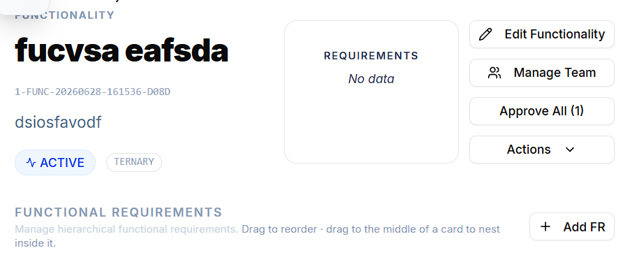
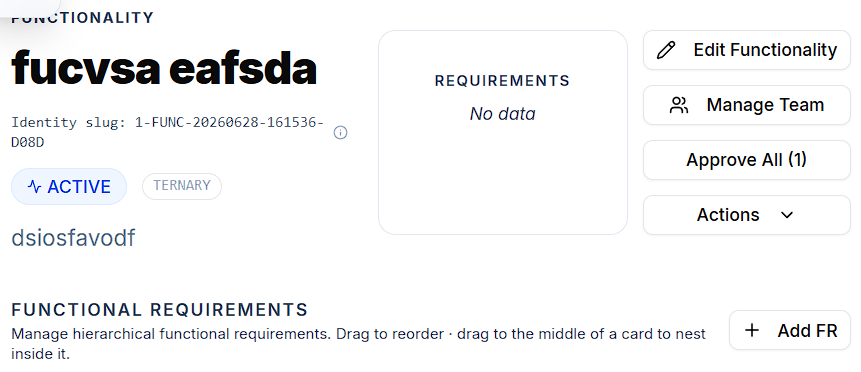

# Usability and Accessibility

## Accessibility

Accessibility is assessed with **Google Lighthouse** audits on each main page, against a target of **80** per measurement. Only the **Performance** and **Accessibility** categories are used. Best Practices and SEO are skipped because the interface is a minimum viable product with a mostly monochrome palette, and because the test deployment has no HTTPS, which Lighthouse flags and which would skew the results.

### Results

| Page | Performance | Accessibility | Main issues |
|---|---|---|---|
| Login | 97 | 97 | none |
| Home | 96 | 77 | `select` elements lack labels, and several elements have insufficient contrast (project counts, reference IDs). |
| Project view | 95 | 90 | Low contrast on references, graph labels, and similar. |
| Stakeholder view | 96 | 90 | Low contrast on the deactivated filter button. |
| Functionality view | 95 | 87 | `button`, `link`, and `menuitem` elements lack accessible names. Low contrast on the page name, identifier, and titles. |
| Functionality detail view | 96 | 90 | Low contrast on the page name, identifier, and titles. |
| Documents view | 96 | 90 | Low contrast on the deactivated filter and graph. |
| User management | 95 | 95 | none |

These are the scores recorded during testing. Only the Home page fell below the target of 80. The fixes below were applied afterward, and the project doesn't record a second audit, so re-run Lighthouse to confirm current scores.

## Usability testing

### Protocol

Participants come from software-related profiles (development, requirements engineering, project management), the system's primary users. Participants with no prior familiarity with IR-Board are preferred, and they get no time to explore before the session, to avoid familiarity bias. Each follows a task-based protocol without help from the observer, thinking aloud throughout. The observer intervenes only if the participant is stuck or unwilling to continue.

The tasks:

1. Sign in with provided credentials.
2. Create a project, open it, and identify its dashboard metrics.
3. Add a stakeholder.
4. Add a functionality.
5. Create a functional requirement, filling in all fields.
6. Link the requirement to the stakeholder.
7. Navigate to the stakeholder's detail view from the requirement's detail view.
8. Create a non-functional requirement with a measurement unit and a target value.
9. Upload a document and link it to the functional requirement.
10. Approve all pending requirements in the functionality.
11. Find an entity by its slug using the NavBar search.
12. Deactivate the functional requirement and verify its new state.
13. Log out.

The observer records time and issues per step, answers a general observation sheet (always / frequently / occasionally / never) on orientation, navigation, form usability, and state-label clarity, and fills in a session summary.

### Results

Four participants completed the scenario. Two completed every step unassisted. A third needed reminders on the slug search, and a fourth needed help on both the slug search and the deactivation. Participants were generally confident until the slug step.

| Step | Task | Slowest participants | Typical issues |
|---|---|---|---|
| 11 | Search by slug | 200 s, 117 s, 84 s, 71 s | Nobody knew what a slug was. It was often missed because of low contrast. One participant expected Enter to open the match, and another didn't see the NavBar on a large screen. |
| 12 | Deactivate and verify state | 179 s, 114 s | Participants didn't see the state badge or the filter, and were confused when the deactivated requirement disappeared from the list. |
| 9 | Upload and link a document | 65 s, 49 s | Participants looked for linking in the document's detail view, but it's only available from the requirement. |
| 4–5 | Add a functionality, create an FR | 25–61 s | Participants expected functionalities alongside the other three project links, and didn't recognize "FR" as an abbreviation. |

Other recurring observations:

- Participants expected the project card to be clickable, not just its "more..." button.
- The NFR numeric values weren't understood until the detail view.
- Some participants used the user image to log out and landed on an invalid route.
- Several disliked abbreviations on buttons, and one found the collapsible NavBar unintuitive.
- Participants praised requirement nesting and reordering, and used the bulk "approve all" helper when it was available.

### Findings and corrections

| Issue | Corrective measure | Status |
|---|---|---|
| Low contrast on the slug and functionality section labels, and across many views (reference IDs, graph labels, page names, titles) | Increase contrast; label the slug clearly | Done for the main elements |
| Deactivated filter missed on element views | Show deactivated elements by default | Done |
| Badges placed where users missed them | Move badges to the right of the slug display | Done |
| Slug and NFR values not understood | Tooltip explaining each | Done for the slug (`EntitySlugDisplay`) |
| Missing accessible names and labels | Add ARIA labels or visible labels | Done for the Home page `select` |
| Project card not clickable | Add navigation to the card | Done |
| User image navigated to an invalid route | Remove the redirect to `/profile` | Done |
| Enter doesn't open slug search results | Keyboard navigation | Open |

The corrections applied were: navigation on the project card, removal of the `/profile` redirect, `showDeactivated` defaulting to true, the new `EntitySlugDisplay` component with a tooltip, higher contrast on the main low-contrast elements, badge repositioning, and an `aria-label` on the Home `select`.

Remaining accessibility items (labels on the Functionality view elements, and tooltips for the NFR values) aren't recorded as done, and keyboard navigation is [future work](../development/contributing.md#open-areas).

### Caveats

- The sessions ran over a LAN VPN because of deployment issues at the time, and setup time is included in the recorded session durations (15–45 minutes).
- The sample is four participants, which is enough to find recurring friction but not to measure it statistically.